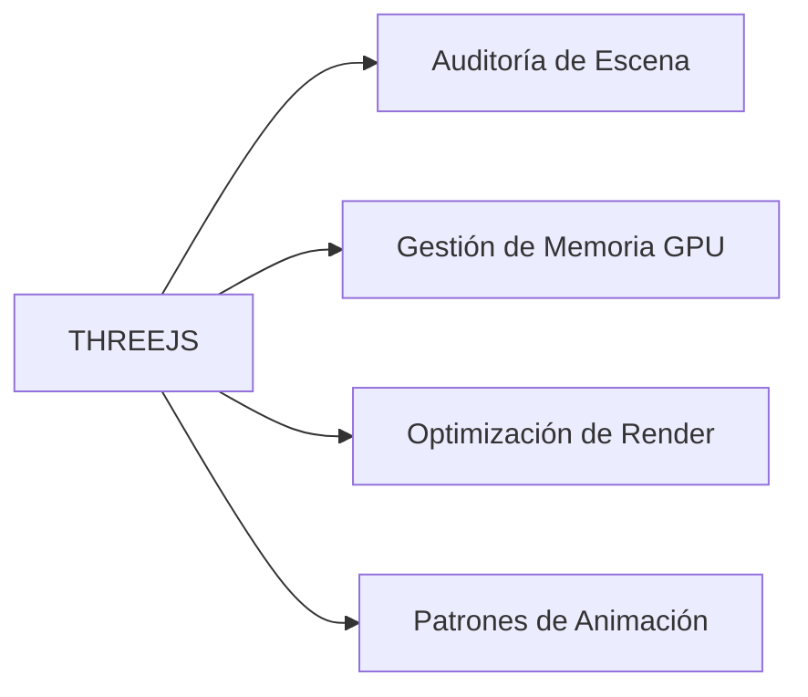

# Three.js Skill Matrix

## Capacidades

## Protocolo de Auditoría (`$threejs:audit`)

1. Detectar archivos con inicialización de Three.js
2. Verificar dispose() en objetos de escena
3. Detectar creación de geometrías/texturas duplicadas
4. Revisar animation loop y gestión de frames
5. Reporte por severidad: fugas GPU (Alta) / antipatrones de render (Media) / mejoras opcionales (Baja)
