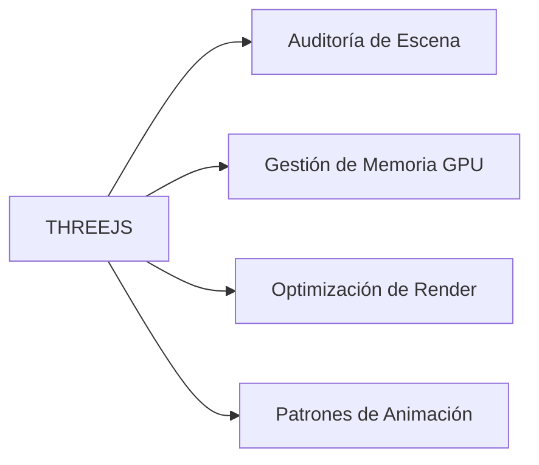

# Three.js Skill Matrix

## Capacidades



## Protocolo de Auditoría (`$threejs:audit`)

1. Detectar archivos con inicialización de Three.js
2. Verificar dispose() en objetos de escena
3. Detectar creación de geometrías/texturas duplicadas
4. Revisar animation loop y gestión de frames
5. Reporte por severidad: fugas GPU (Alta) / antipatrones de render (Media) / mejoras opcionales (Baja)


---

## 📝 Persistencia y Salida Activa (`overview/work/skill/`)

Al ejecutar esta skill (mediante `$threejs` o `$threejs:audit`), es **obligatorio crear o actualizar su reporte activo** dentro del proyecto cliente en la ruta:

`overview/work/skill/three-js.md`

### Estructura Requerida del Reporte:

```markdown
# 📋 Registro Activo de Tareas — Three.js Agent Skill

> **Generado por**: `three-js-agent-skills` (`$threejs:audit`)  
> **Última actualización**: YYYY-MM-DD  

## 🎯 Tareas Pendientes Accionables

| ID | Tipo | Estado | Resumen | Evidencia/Ruta | Acción Requerida |
|---|---|---|---|---|---|
| 3JS-01 | Fix / Refactor | Pendiente | <Resumen breve> | `<ruta:línea>` | <Remediación recomendada> |

## 📝 Observaciones y Detalles de Revisión
- Detalle técnico, evidencia o contexto extendido proporcionado por la revisión de la skill.
```
