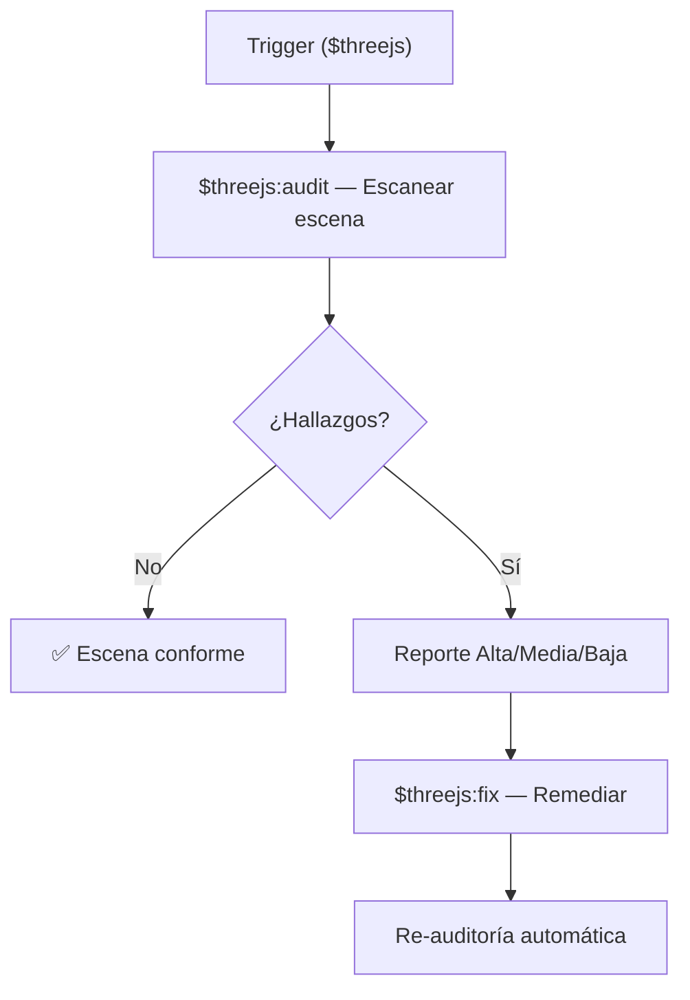

# Motor de Decisiones — Three.js

## Flujo

## Matriz de Decisión

| Situación | Severidad | Acción |
|---|---|---|
| Objeto sin `.dispose()` | Alta | Fix inmediato — fuga de memoria GPU |
| Geometría duplicada por objeto | Alta | Migrar a `InstancedMesh` |
| Textura cargada múltiples veces | Media | Implementar caché de `TextureLoader` |
| Shader sin optimización | Baja | Sugerir mejora opcional |
